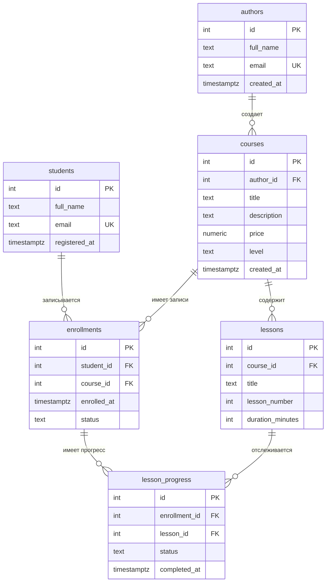

# База данных «Онлайн-курсы»

Тема № 10: Онлайн-курсы.

База данных предназначена для хранения информации об онлайн-курсах, авторах, учениках, уроках и прохождении обучения. Она позволяет учитывать записи учеников на курсы и отслеживать прогресс прохождения уроков.

| Параметр | Описание |
|---|---|
| Главная таблица | `courses` — онлайн-курсы |
| Связь N:M | Ученики и курсы через `enrollments` |
| Бизнес-правило | Следующий урок открывается только после прохождения предыдущего |
| СУБД | PostgreSQL 17 в Docker |

Бизнес-правило будет реализовано в лабораторной № 3. В первой лабораторной создаётся структура для хранения прогресса.

## Задания курса

Правила курса и порядок сдачи: [docs/README.md](docs/README.md).

| Лабораторная | Задание |
|---|---|
| 1. Модель данных и схема | [lab-1.md](docs/lab-1.md) |
| 2. Запросы | [lab-2.md](docs/lab-2.md) |
| 3. Логика в базе | [lab-3.md](docs/lab-3.md) |
| 4. Транзакции и доступ | [lab-4.md](docs/lab-4.md) |
| 5. Производительность | [lab-5.md](docs/lab-5.md) |
| Витрина к защите | [showcase.md](docs/showcase.md) |

## Как запустить

Создать файл `.env` из `.env.example` и указать пароли.

Запустить базу данных:

```bash
docker compose up -d
```

Открыть PostgreSQL:

```bash
docker compose exec db psql -U postgres -d app
```

Проверить первую лабораторную:

```bash
dbcheck --lab 1 --stars
dbcheck --lab 1 --fresh
dbcheck run demo/lab1.sql
```

После изменения скриптов в папке `db/` базу необходимо пересоздать:

```bash
docker compose down -v
docker compose up -d
```

## ER-диаграмма

В базе данных используется шесть таблиц. Каждая таблица имеет первичный ключ. Для связи учеников и курсов используется отдельная таблица `enrollments`, реализующая отношение многие ко многим.



Обозначения:
- PK — первичный ключ.
- FK — внешний ключ.
- UK — уникальное значение.
- 1:N — одной записи соответствует несколько записей в другой таблице.
- N:M — многие ко многим.

Связь N:M между `students` и `courses` реализована через таблицу `enrollments`. В ней находятся два внешних ключа: `student_id` и `course_id`. Ограничение `UNIQUE (student_id, course_id)` запрещает повторную запись одного ученика на один курс.

## Описание таблиц

| Таблица | Назначение |
|---|---|
| `authors` | Информация об авторах курсов |
| `students` | Информация об учениках |
| `courses` | Сведения об онлайн-курсах |
| `lessons` | Уроки, входящие в курсы |
| `enrollments` | Записи учеников на курсы |
| `lesson_progress` | Состояние прохождения отдельных уроков |

## Ограничения

| Ограничение | Таблица и колонки | Зачем |
|---|---|---|
| PRIMARY KEY | `id` во всех таблицах | Уникальная идентификация записи |
| NOT NULL | `full_name`, `title`, `status` и другие обязательные поля | Запрет пустых обязательных значений |
| UNIQUE | `authors.email` | Запрет повторения email автора |
| UNIQUE | `students.email` | Запрет повторения email ученика |
| UNIQUE | `lessons(course_id, lesson_number)` | Запрет одинаковых номеров уроков внутри курса |
| UNIQUE | `enrollments(student_id, course_id)` | Один ученик не может повторно записаться на тот же курс |
| UNIQUE | `lesson_progress(enrollment_id, lesson_id)` | Одна запись прогресса для урока в рамках зачисления |
| CHECK | `courses.price >= 0` | Стоимость курса не может быть отрицательной |
| CHECK | `courses.level` | Разрешены только заданные уровни сложности |
| CHECK | `lessons.lesson_number > 0` | Номер урока должен быть положительным |
| CHECK | `lessons.duration_minutes > 0` | Продолжительность урока должна быть положительной |
| CHECK | `enrollments.status` | Разрешены только active, completed, cancelled |
| CHECK | `lesson_progress.status` | Разрешены только available и completed |
| CHECK | `lesson_progress.completed_at` | Дата завершения должна соответствовать статусу прохождения |
| FOREIGN KEY | Внешние ключи между таблицами | Запрет ссылок на несуществующие записи |

## Нормализация

Первоначально всю информацию об онлайн-обучении можно было хранить в одной большой таблице.

Например:

| Ученик | Email ученика | Курс | Автор | Урок |
|---|---|---|---|---|
| Алина Сергеева | student01@example.test | Основы Python | Анна Иванова | Введение |
| Алина Сергеева | student01@example.test | Основы Python | Анна Иванова | Практика |
| Кирилл Орлов | student02@example.test | Основы Python | Анна Иванова | Введение |

В такой таблице постоянно повторяются сведения об учениках, курсах и авторах. Если изменится email ученика или имя автора, придётся исправлять его сразу в нескольких строках. Это может привести к ошибкам и противоречивым данным.

### Первая нормальная форма (1НФ)

Каждая ячейка должна содержать только одно значение, а каждая строка — описывать отдельную запись.

Поэтому нельзя хранить несколько уроков в одном поле через запятую. Каждый урок должен иметь отдельную запись.

### Вторая нормальная форма (2НФ)

Все неключевые атрибуты должны зависеть от полного ключа, а не только от его части.

Например, в общей таблице прохождений с составным ключом из ученика, курса и урока имя ученика зависит только от ученика, а название курса — только от курса.

Поэтому сведения об учениках вынесены в `students`, о курсах — в `courses`, об уроках — в `lessons`.

### Третья нормальная форма (3НФ)

Неключевые атрибуты не должны зависеть друг от друга через другие неключевые атрибуты.

Например, имя и email автора зависят от автора, а не от курса. Поэтому данные автора находятся в отдельной таблице `authors`, а курс хранит только `author_id`.

Также в таблице `lesson_progress` не дублируются название курса, имя ученика и название урока. Для получения этих сведений используются связи между таблицами.

В результате данные разделены на шесть таблиц. Это уменьшает дублирование и помогает избежать ошибок при изменении информации.

## Выбор типов данных

| Тип | Где используется | Почему |
|---|---|---|
| integer | ID, номера уроков, продолжительность | Для хранения целых чисел |
| text | Имена, email, названия, описания | Для хранения текстовой информации |
| numeric(10,2) | Стоимость курса | Для точного хранения денежных сумм |
| timestamptz | Даты регистрации, создания и завершения | Для хранения даты и времени с учётом часового пояса |

Для статусов используются ограничения `CHECK`, которые разрешают только заранее определённые значения.

## Поведение ON DELETE

Для каждого внешнего ключа задано правило удаления связанных записей.

| Связь | ON DELETE | Обоснование |
|---|---|---|
| `courses.author_id` → `authors.id` | RESTRICT | Нельзя удалить автора, пока у него есть курсы |
| `lessons.course_id` → `courses.id` | CASCADE | При удалении курса удаляются его уроки |
| `enrollments.student_id` → `students.id` | CASCADE | При удалении ученика удаляются его записи на курсы |
| `enrollments.course_id` → `courses.id` | CASCADE | При удалении курса удаляются записи учеников на него |
| `lesson_progress.enrollment_id` → `enrollments.id` | CASCADE | При удалении записи на курс удаляется соответствующий прогресс |
| `lesson_progress.lesson_id` → `lessons.id` | CASCADE | При удалении урока удаляется его прогресс |

`RESTRICT` запрещает удаление родительской записи, если на неё ссылаются другие таблицы.

`CASCADE` автоматически удаляет зависимые записи вместе с родительской.

## Тестовые данные

Данные создаются SQL-скриптами:

- `db/01_schema.sql` — создание таблиц и ограничений.
- `db/02_seed.sql` — основные тестовые данные.
- `db/03_generate.sql` — генерация 1200 дополнительных учеников и записей на курсы.

При создании базы с нуля ожидается 2510 записей во всех таблицах суммарно.

## Проверка неправильных вставок

В `demo/lab1.sql` находятся три проверки:

1. UNIQUE — попытка вставить автора с уже существующим email.
2. CHECK — попытка создать курс с отрицательной стоимостью.
3. FOREIGN KEY — попытка создать курс с несуществующим автором.

База должна отклонить все три операции с соответствующими ошибками.

## Что сделано по лабораторным

| Лабораторная | Что сделано | Сценарий |
|---|---|---|
| 1 | Схема из 6 таблиц, ограничения, тестовые данные, нормализация, ON DELETE | `demo/lab1.sql` |

Лабораторные № 2–5 выполняются на следующих этапах курса.
